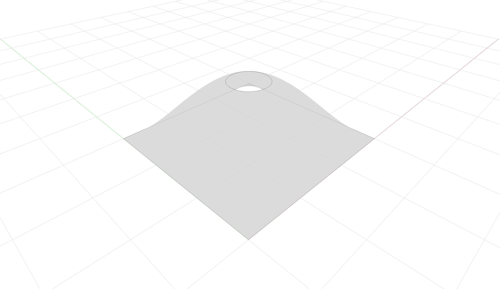

# Brep with Hole

This example builds a trimmed NURBS face and converts it to a precision-controlled
triangle tessellation. Linear deflection is expressed in model units and angular
deflection in degrees; the OCC provider converts the angular value to radians once
at the Open CASCADE boundary. The returned `Tessellation.polylines` contain
discretized BRep edge boundaries, including the trimmed hole.

OCC triangulates every face independently. Therefore, coincident vertices along
shared edges and periodic seams remain duplicated in the indexed triangle buffers.
The tessellation preserves the geometric boundary, but its indices should not be
assumed to form a welded or topologically watertight mesh. Convert explicitly and
weld separately if a downstream operation requires that topology. A BRep does not
offer a polygonal-surface conversion; convert the returned `Tessellation` explicitly
if that separate representation is needed.

The trims belong to the BRep face, not to its underlying NURBS surface. Extracting
`face.nurbssurface` and converting that surface produces the untrimmed parameter
domain; it does not preserve the outer boundary or the hole constructed here.



```python
---8<--- "docs/examples/breps/brep_with_hole.py"
```
