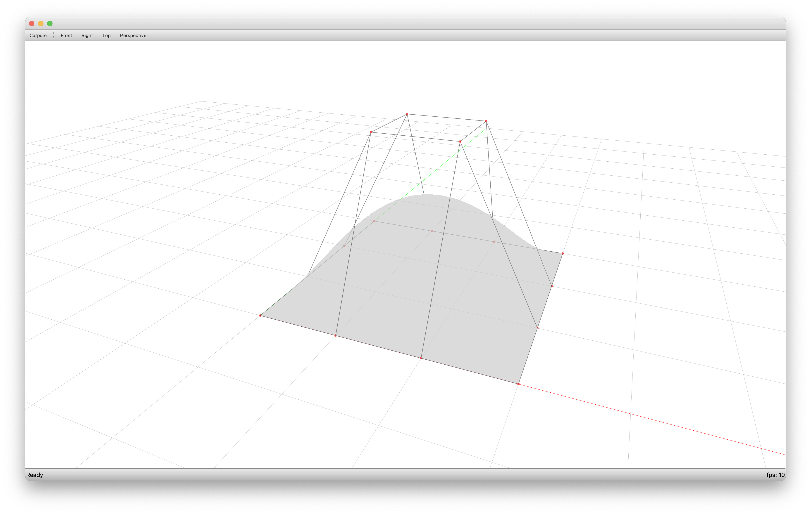

# Surface JSON Data




```python
---8<--- "docs/examples/surfaces/surface_jsondata.py"
```

```json
{
    "is_u_periodic": false,
    "is_v_periodic": false,
    "points": [
        [
            [
                0.0,
                0.0,
                0.0
            ],
            [
                1.0,
                0.0,
                0.0
            ],
            [
                2.0,
                0.0,
                0.0
            ],
            [
                3.0,
                0.0,
                0.0
            ]
        ],
        [
            [
                0.0,
                1.0,
                0.0
            ],
            [
                1.0,
                1.0,
                2.0
            ],
            [
                2.0,
                1.0,
                2.0
            ],
            [
                3.0,
                1.0,
                0.0
            ]
        ],
        [
            [
                0.0,
                2.0,
                0.0
            ],
            [
                1.0,
                2.0,
                2.0
            ],
            [
                2.0,
                2.0,
                2.0
            ],
            [
                3.0,
                2.0,
                0.0
            ]
        ],
        [
            [
                0.0,
                3.0,
                0.0
            ],
            [
                1.0,
                3.0,
                0.0
            ],
            [
                2.0,
                3.0,
                0.0
            ],
            [
                3.0,
                3.0,
                0.0
            ]
        ]
    ],
    "u_degree": 3,
    "u_knots": [
        0.0,
        1.0
    ],
    "u_mults": [
        4,
        4
    ],
    "v_degree": 3,
    "v_knots": [
        0.0,
        1.0
    ],
    "v_mults": [
        4,
        4
    ],
    "weights": [
        [
            1.0,
            1.0,
            1.0,
            1.0
        ],
        [
            1.0,
            1.0,
            1.0,
            1.0
        ],
        [
            1.0,
            1.0,
            1.0,
            1.0
        ],
        [
            1.0,
            1.0,
            1.0,
            1.0
        ]
    ]
}
```
